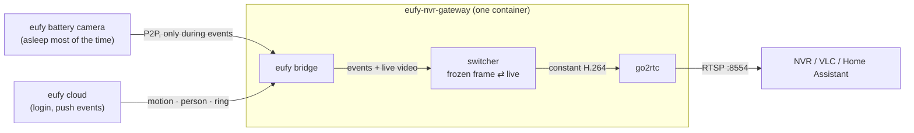

# eufy NVR gateway

**Always-on RTSP streams for battery-powered eufy cameras — without keeping them awake.**

Network video recorders (Synology Surveillance Station, Frigate, Blue Iris, …) hold
a camera's stream open around the clock. A battery-powered eufy camera (SoloCam, battery
doorbells, eufyCam) cannot stream around the clock: it has no RTSP at all, and keeping its live view
open would drain the battery in days.

This gateway sits in between and runs as **one Docker container**:

- Every camera gets a **constant H.264 RTSP stream** that never drops, so the NVR is always happy.
- While nothing happens, that stream shows the **last frame, frozen and slightly blurred**, with a
  `LAST SEEN 18:33:15` label — and the camera **sleeps**.
- When the camera detects motion or a person, or the doorbell is pressed, the gateway **wakes the
  camera, switches the stream to live video** for two minutes, then freezes the last frame again.



## Features

- **One image, one config file.** The eufy bridge, go2rtc and the switcher run together under a
  small supervisor that restarts anything that crashes.
- **Battery-friendly by design.** A camera only streams during an event; the raw camera stream is
  never reachable from the network, so nothing can keep a camera awake by accident.
- **Full resolution.** Output is the camera's native live resolution (e.g. 2880×1616 for a 3K
  SoloCam). Measured image quality against the camera's own stream: SSIM 0.993–0.997.
- **H.265 handled.** Cameras that send H.265 (HEVC) are converted to H.264, which every NVR accepts.
- **Cheap while idle.** The frozen picture costs ~0.1–0.6 Mbit/s per camera.
- **Web page** for the eufy login (2FA code / captcha), live status, stream URLs, manual
  *Go live* / *Stop*, and the list of devices on your account (to copy serial numbers from).

## Requirements

- A Docker host on your LAN, 64-bit x86 or ARM (developed on a Synology DS923+ with Container Manager).
  Converting a 3K H.265 camera to H.264 needs about one CPU core while a camera is live.
- A **separate eufy account** for the gateway. eufy allows one active session per account; if the
  gateway and your phone app share an account, they keep logging each other out. Create a second
  account and share your cameras with it from the eufy app (with admin rights).
- The cameras must be **armed** in a mode that detects motion/persons — a disarmed camera sends no
  events, so it never goes live.

## Quick start

1. **Create a folder** for the gateway, e.g. `/volume1/docker/eufy-nvr-gateway` on a Synology.
2. **Copy** [`examples/docker-compose.yml`](examples/docker-compose.yml) into it and fill in
   `EUFY_EMAIL`, `EUFY_PASSWORD` and `EUFY_COUNTRY` (the two-letter country the account was
   registered in).
3. **Create `config.json`** in the same folder with an empty camera list for now:

   ```json
   { "timezone": "Europe/London", "cameras": [] }
   ```

4. **Start it**: `docker compose up -d`, or on a Synology: *Container Manager → Project → Create*,
   choose the folder and *Use existing docker-compose.yml*.
5. **Log in**: open `http://<host>:8099`. If eufy asks for a verification code (usually e-mailed) or
   a captcha, enter it there. The login is stored in `data/` and survives restarts.
6. **Add your cameras**: the page lists every device on the account with its serial number. Add
   them to `config.json` (see below) and restart the container.
7. **Watch**: `rtsp://<host>:8554/<camera-name>` in VLC, or add that URL to your NVR.

## Configuration

`config.json` (mounted at `/config/config.json`):

```json
{
  "timezone": "Europe/London",
  "cameras": [
    { "name": "front-door", "serial": "T81XXXXXXXXXXXXX", "width": 2048, "height": 1536 },
    { "name": "garden", "serial": "T81XXXXXXXXXXXXX", "width": 2880, "height": 1616, "bitrateKbps": 6000 }
  ]
}
```

Per camera:

| Key | Required | Meaning |
|---|---|---|
| `name` | yes | Letters, digits, `-`, `_`. Becomes the RTSP path: `rtsp://<host>:8554/<name>` |
| `serial` | yes | The camera's serial number (shown on the web page after login) |
| `width`, `height` | yes | The camera's **native live resolution**. The output always has this size; set it to what the camera really sends so nothing is scaled. See [known resolutions](#known-live-resolutions) |
| `fps` | | Output frame rate. Default `15` (what eufy cameras send) |
| `bitrateKbps` | | Upper bitrate limit during live video. Default `4000`; use ~`6000` for 3K |
| `holdMs` | | How long to stay live after the last detection. Default `120000` (2 min) |
| `ringHoldMs` | | Same, after a doorbell press. Default `120000` |
| `maxLiveMs` | | Hard cap per session, from the first live frame. Default `120000` |
| `restartGapMs` | | Minimum pause between sessions (a doorbell press ignores it). Default `15000` |
| `minBatteryPct` | | Below this battery level, only a doorbell press or a manual *Go live* wakes the camera. Default `15` |
| `idleBlur` | | Blur of the frozen picture (pixels at 1080p, scaled to the resolution). `0` = sharp. Default `2` |
| `triggers` | | Events that wake the camera. Default: `motion`, `personDetected`, `vehicleDetected`, `petDetection`, `strangerDetected`, `doorbellPress` |

Top level: `timezone` (for the `LAST SEEN` label), `defaults` (any per-camera key, applied to all
cameras), `ports`, `bridge`. Everything is described in
[docs/configuration.md](docs/configuration.md), with a complete example in
[`examples/config.full.example.json`](examples/config.full.example.json).

Environment variables: `EUFY_EMAIL`, `EUFY_PASSWORD`, `EUFY_COUNTRY` (required), `TZ`, `WEB_PORT`.

### Known live resolutions

Measured on real devices; other models: start with 1920×1080 and check the web page snapshot.

| Model | Camera | Live stream |
|---|---|---|
| T8170 | SoloCam S340 | 2880×1616, H.265, 15 fps (steps up from 720p during the first ~8 s) |
| T8210 | Video Doorbell (battery, via HomeBase) | 2048×1536, H.264, 15 fps |

## Ports

All on the host (host networking):

| Port | What |
|---|---|
| `8099` | Web page and API |
| `8554` | RTSP streams — `rtsp://<host>:8554/<name>` |
| `1984` | go2rtc web UI (stream debugging, WebRTC/MSE players) |
| `8555` | go2rtc WebRTC |
| `3000` | eufy bridge — **localhost only**, deliberately not reachable from the LAN |

Change them under `"ports"` in `config.json` if something else on the host already uses one.

## API

| Request | What |
|---|---|
| `GET /api/status` | Login state and every camera's state (`IDLE` / `WAKING` / `LIVE`), battery, last seen |
| `GET /api/devices` | Devices on the eufy account, with serial numbers |
| `GET /api/cameras/<name>/snapshot.jpg` | What the stream shows right now |
| `POST /api/cameras/<name>/live` | Wake the camera and go live (e.g. from a Home Assistant button) |
| `POST /api/cameras/<name>/idle` | End the live session now |
| `POST /api/login` | `{ "code": "123456" }` or `{ "captcha": "AB3D" }` |

## How it works

The short version: one ffmpeg encoder per camera runs forever and feeds go2rtc. The switcher hands
it either the frozen picture or decoded live frames, so the NVR sees one unbroken stream. Details,
measurements and the problems solved along the way: [docs/how-it-works.md](docs/how-it-works.md).

## Roadmap

- **ONVIF for UniFi Protect** (next). UniFi Protect only adopts ONVIF cameras, treats each one as a
  separate device with its own MAC and IP address, and records third-party cameras on motion only if
  they send ONVIF motion events. Plan: publish every camera as a virtual ONVIF device (one macvlan
  interface per camera on the host) and raise ONVIF *motion* exactly while the camera is live, so
  Protect records just the live sessions. A prototype based on
  [onvif-server](https://github.com/daniela-hase/onvif-server) with a motion-events patch works in
  the lab; it will land here once it has been tested with a real Protect console.
- Ideas: show each camera's detected source resolution on the web page; optional password for the
  web page; Home Assistant MQTT discovery for the *Go live* buttons.

## Troubleshooting

| Symptom | Cause / fix |
|---|---|
| Web page says `require_2fa` / `require_captcha` | Enter the code or captcha on the page. Avoid repeated wrong attempts — eufy may block the account for a while. |
| Login keeps failing, `Email address or password incorrect` | Check `EUFY_EMAIL`, `EUFY_PASSWORD` and `EUFY_COUNTRY` — the country must be where the account was registered. |
| The gateway gets logged out now and then | Another login on the same account (phone app, Home Assistant, another bridge) took over the session. Use a dedicated account. |
| A camera never goes live on motion | It is disarmed, or detection is off in the eufy app. A disarmed camera sends no events. Test with the *Go live* button. |
| Live video takes 10–60 s to appear | Normal for battery cameras: waking takes 3–12 s, deep sleep longer. The stream shows `CONNECTING…` meanwhile. |
| The first seconds of live video look soft | Some cameras start at a lower resolution and step up (the SoloCam S340 reaches 3K after ~8 s). |
| Picture is stretched or letterboxed | `width`/`height` don't match the camera's native resolution. |
| High CPU on the host | Live sessions of H.265 3K cameras are expensive (~1 core). Lower `width`/`height` to trade detail for CPU. |
| Port already in use | Change it under `"ports"` in `config.json`. |

Logs: `docker logs eufy-nvr-gateway` (every line is prefixed with `[bridge]`, `[go2rtc]` or
`[switcher]`).

## Security

- The web page and API have **no authentication**. Keep port 8099 on your LAN; never forward it to
  the internet. Same for RTSP and go2rtc.
- The eufy password is passed as an environment variable and used only by the bundled bridge to log
  in to eufy. The login session is stored in `data/bridge/`.

## Credits and licenses

This project is MIT licensed (see [LICENSE](LICENSE)). It builds on, and the Docker image bundles:

- [ha-eufy-sdk-bridge](https://github.com/mega-yfue/ha-eufy-sdk-bridge) and
  [eufy-sdk](https://github.com/mega-yfue/eufy-sdk) by mega-yfue — Apache-2.0
- [go2rtc](https://github.com/AlexxIT/go2rtc) by AlexxIT — MIT
- [FFmpeg](https://ffmpeg.org) with x264 (Alpine packages) — LGPL/GPL

See [NOTICE.md](NOTICE.md). Not affiliated with Anker, eufy or any NVR vendor.
