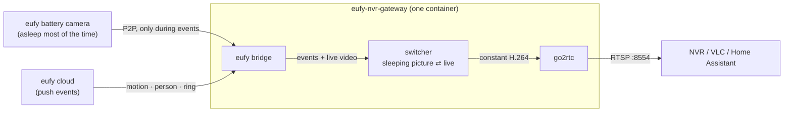

# Eufy NVR Gateway

[](https://hub.docker.com/r/dbanky/eufy-nvr-gateway)
[](https://hub.docker.com/r/dbanky/eufy-nvr-gateway/tags)
[](https://hub.docker.com/r/dbanky/eufy-nvr-gateway/tags)

**Always-on RTSP streams for battery-powered eufy cameras — without keeping them awake.**

Network video recorders (Synology Surveillance Station, Frigate, Blue Iris, …) hold
a camera's stream open around the clock. A battery-powered eufy camera (SoloCam, battery
doorbells, eufyCam) cannot stream around the clock: it has no RTSP at all, and keeping its live view
open would drain the battery in days.

This gateway sits in between and runs as **one Docker container**:

- Every camera gets a **constant H.264 RTSP stream** that never drops, so the NVR is always happy.
- While nothing happens, the stream shows the **last frame, blurred and dimmed, with a moon** and a
  `Sleeping · since 18:33` label — and the camera **sleeps**.
- When the camera detects motion or a person, or the doorbell is pressed, the gateway **wakes the
  camera and switches the stream to live video** — until there has been no motion for 30 seconds —
  then shows the sleeping picture again.



## Features

- **One image, one config file.** The eufy bridge, go2rtc and the switcher run together under a
  small supervisor that restarts anything that crashes.
- **Battery-friendly by design.** A camera only streams during an event; the raw camera stream is
  never reachable from the network, so nothing can keep a camera awake by accident.
- **Full resolution.** Output is the camera's native live resolution (e.g. 2880×1616 for a 3K
  SoloCam). Measured image quality against the camera's own stream: SSIM 0.993–0.997.
- **H.265 handled.** Cameras that send H.265 (HEVC) are converted to H.264, which every NVR accepts.
- **Clear states on the stream.** Sleeping, waking up, low battery, didn't wake up, offline: each
  has its own icon and a short label, readable even in a small NVR tile. Live video stays clean.
- **Almost free while idle.** The sleeping picture is encoded once and replayed: well under 1 % of
  a CPU core and ~0.1–0.6 Mbit/s per camera.
- **Web page** for the eufy login (2FA code / captcha), live status, stream URLs, manual
  *Go live* / *Stop*, and the list of devices on your account (to copy serial numbers from).

## Requirements

- A Docker host on your LAN, 64-bit x86 or ARM (developed on a Synology DS923+ with Container Manager).
  Converting a 3K H.265 camera to H.264 needs about one CPU core while a camera is live.
- A **separate eufy account** for the gateway. eufy allows one active session per account; if the
  gateway and your phone app share an account, they keep logging each other out. Create a second
  account and share your cameras with it from the eufy app (with admin rights).
- The cameras must be **armed** in a mode that detects motion/persons — a disarmed camera sends no
  events, so it never goes live.

## Installation

Ready-made images for 64-bit x86 (`amd64`) and ARM (`arm64`) are published for every release:

| Registry | Image |
|---|---|
| [Docker Hub](https://hub.docker.com/r/dbanky/eufy-nvr-gateway) | `dbanky/eufy-nvr-gateway` |
| [GitHub Container Registry](https://github.com/dbanky/eufy-nvr-gateway/pkgs/container/eufy-nvr-gateway) | `ghcr.io/dbanky/eufy-nvr-gateway` |

| Tag | Meaning |
|---|---|
| `latest` | The newest stable release |
| `0.2.1`, … | One exact version — pin it to update only when you choose to |
| `0.1.1-rc.1`, … | Pre-releases for testing; never become `latest` |

The container needs one folder, mounted at `/data`. It holds your `config.json` (the camera list),
the eufy login session and the last frame of every camera, so all of it survives updates.

### Synology (Container Manager)

The image is on Docker Hub, Container Manager's built-in registry — nothing needs to be added.

1. **Download the image**: *Container Manager → Registry*, search for `eufy-nvr-gateway`, select
   `dbanky/eufy-nvr-gateway`, *Download*, tag `latest`.
2. **Create the container**: *Container Manager → Image*, select the image, *Run*:
   - Container name `eufy-nvr-gateway`, tick *Enable auto-restart*.
   - **Volume**: add a folder (e.g. create `docker/eufy-nvr-gateway`) with mount path `/data`.
   - **Network**: `host`.
   - **Environment**: `EUFY_EMAIL`, `EUFY_PASSWORD`, `EUFY_COUNTRY` (the two-letter code of the
     country the account was registered in, e.g. `GB`, `DE`, `US`) and `TZ` (e.g. `Europe/London`).
3. **Log in**: open `http://<nas>:8099`. If eufy asks for a verification code (usually e-mailed) or a
   captcha, enter it there.
4. **Add your cameras**: the page lists every device on the account with its serial number. Write
   your [`config.json`](#configuration), put it into the folder from step 2 (e.g. with File
   Station), then restart the container (*Container → Action → Restart*).
5. **Watch**: `rtsp://<nas>:8554/<camera-name>` in VLC, or add that URL to your NVR.

**Updating**: download the tag again in *Registry* (it fetches the newest image), then stop the
container and use *Action → Reset* to recreate it from the new image. The folder is kept.

### Other Docker hosts

```sh
docker run -d --name eufy-nvr-gateway --restart unless-stopped --network host \
  -e EUFY_EMAIL=you@example.com -e EUFY_PASSWORD='your-eufy-password' \
  -e EUFY_COUNTRY=GB -e TZ=Europe/London \
  -v "$PWD/data:/data" dbanky/eufy-nvr-gateway:latest
```

or with Compose: [`examples/docker-compose.yml`](examples/docker-compose.yml). Then continue with
steps 3–5 above; `config.json` goes into `./data`.

## Configuration

`config.json` in the data folder (`/data/config.json` in the container):

```json
{
  "timezone": "Europe/London",
  "cameras": [
    { "name": "front-door", "serial": "T81XXXXXXXXXXXXX", "width": 2048, "height": 1536 },
    { "name": "garden", "serial": "T81XXXXXXXXXXXXX", "width": 2880, "height": 1616, "bitrateKbps": 6000 }
  ]
}
```

Per camera:

| Key | Required | Meaning |
|---|---|---|
| `name` | yes | Letters, digits, `-`, `_`. Becomes the RTSP path: `rtsp://<host>:8554/<name>` |
| `serial` | yes | The camera's serial number (shown on the web page after login) |
| `width`, `height` | yes | The camera's **native live resolution**. The output always has this size; set it to what the camera really sends so nothing is scaled. See [known resolutions](#known-live-resolutions) |
| `fps` | | Output frame rate. Default `15` (what eufy cameras send) |
| `bitrateKbps` | | Upper bitrate limit during live video. Default `4000`; use ~`6000` for 3K |
| `holdMs` | | Stay live until this long after the last detection: continuing motion keeps the stream live. Default `30000` (30 s) |
| `ringHoldMs` | | Same, after a doorbell press. Default `120000` (2 min) |
| `maxLiveMs` | | Optional cap per session, from the first live frame, to save battery when motion never stops (e.g. a busy street). Default `0` (no cap) |
| `restartGapMs` | | Minimum pause between sessions (a doorbell press ignores it). Default `15000` |
| `minBatteryPct` | | Below this battery level, only a doorbell press or a manual *Go live* wakes the camera. Default `15` |
| `triggers` | | Events that wake the camera. Default: `motion`, `personDetected`, `vehicleDetected`, `petDetection`, `strangerDetected`, `doorbellPress` |

Top level: `timezone` (for the `since 18:33` label), `defaults` (any per-camera key, applied to all
cameras), `ports`, `bridge`. Everything is described in
[docs/configuration.md](docs/configuration.md), with a complete example in
[`examples/config.full.example.json`](examples/config.full.example.json).

Environment variables: `EUFY_EMAIL`, `EUFY_PASSWORD`, `EUFY_COUNTRY` (required), `TZ`, `WEB_PORT`.

### Known live resolutions

Measured on real devices; other models: start with 1920×1080 and check the web page snapshot.

| Model | Camera | Live stream |
|---|---|---|
| T8170 | SoloCam S340 | 2880×1616, H.265, 15 fps (steps up from 720p during the first ~8 s) |
| T8210 | Video Doorbell (battery, via HomeBase) | 2048×1536, H.264, 15 fps |

## Ports

All on the host (host networking):

| Port | What |
|---|---|
| `8099` | Web page and API |
| `8554` | RTSP streams — `rtsp://<host>:8554/<name>` |

Change them under `"ports"` in `config.json` if something else on the host already uses one.

## API

| Request | What |
|---|---|
| `GET /api/status` | Login state and every camera's state (`IDLE` / `WAKING` / `LIVE`), battery, last seen |
| `GET /api/devices` | Devices on the eufy account, with serial numbers |
| `GET /api/cameras/<name>/snapshot.jpg` | What the stream shows right now |
| `POST /api/cameras/<name>/live` | Wake the camera and go live (e.g. from a Home Assistant button) |
| `POST /api/cameras/<name>/idle` | End the live session now |
| `POST /api/login` | `{ "code": "123456" }` or `{ "captcha": "AB3D" }` |

## How it works

The short version: per camera, one never-ending stream feeds go2rtc. While the camera sleeps it
replays a picture that was encoded once; during an event a live encoder takes over, spliced in at a
keyframe, so the NVR sees one unbroken stream. Details,
measurements and the problems solved along the way: [docs/how-it-works.md](docs/how-it-works.md).

## Roadmap

- **ONVIF for UniFi Protect** (next). UniFi Protect only adopts ONVIF cameras, treats each one as a
  separate device with its own MAC and IP address, and records third-party cameras on motion only if
  they send ONVIF motion events. Plan: publish every camera as a virtual ONVIF device (one macvlan
  interface per camera on the host) and raise ONVIF *motion* exactly while the camera is live, so
  Protect records just the live sessions. A prototype based on
  [onvif-server](https://github.com/daniela-hase/onvif-server) with a motion-events patch works in
  the lab; it will land here once it has been tested with a real Protect console.
- Ideas: show each camera's detected source resolution on the web page; optional password for the
  web page; Home Assistant MQTT discovery for the *Go live* buttons.

## Troubleshooting

| Symptom | Cause / fix |
|---|---|
| Web page says `require_2fa` / `require_captcha` | Enter the code or captcha on the page. Avoid repeated wrong attempts — eufy may block the account for a while. |
| Login keeps failing, `Email address or password incorrect` | Check `EUFY_EMAIL`, `EUFY_PASSWORD` and `EUFY_COUNTRY` — the country must be where the account was registered. |
| The gateway gets logged out now and then | Another login on the same account (phone app, Home Assistant, another bridge) took over the session. Use a dedicated account. |
| A camera never goes live on motion | It is disarmed, or detection is off in the eufy app. A disarmed camera sends no events. Test with the *Go live* button. |
| Live video takes 10–60 s to appear | Normal for battery cameras: waking takes 3–12 s, deep sleep longer. The stream shows `Waking up` meanwhile. |
| The first seconds of live video look soft | Some cameras start at a lower resolution and step up (the SoloCam S340 reaches 3K after ~8 s). |
| Picture is stretched or letterboxed | `width`/`height` don't match the camera's native resolution. |
| High CPU on the host | Live sessions of H.265 3K cameras are expensive (~1 core). Lower `width`/`height` to trade detail for CPU. |
| Port already in use | Change it under `"ports"` in `config.json`. |

Logs: `docker logs eufy-nvr-gateway` (every line is prefixed with `[bridge]`, `[go2rtc]` or
`[switcher]`).

## Security

- The web page and API have **no authentication**. Keep port 8099 on your LAN; never forward it to
  the internet. Same for the RTSP port 8554.
- The eufy password is passed as an environment variable and used only by the bundled bridge to log
  in to eufy. The login session is stored in `data/bridge/`.

## Development

```sh
npm test            # unit tests: Node 22+, no dependencies (node:test)
npm run check       # syntax check of every file
docker build -t eufy-nvr-gateway:dev .
```

The code is split by concern; the tests in `test/` mirror it and read as a description of the
behaviour:

| Folder | What |
|---|---|
| `src/main.mjs`, `src/gateway/` | Container entrypoint: reads `config.json`, writes the configs for the bundled services, runs and restarts them |
| `src/switcher/` | One process for all cameras: the state of each camera (`camera.mjs`), when to wake and sleep (`policy.mjs`), what the stream says (`labels.mjs`), the eufy bridge connection, the web page and API |
| `src/video/` | The never-ending stream: the publisher, what it plays next (`feed.mjs`), the live encoder and decoder, H.264 helpers |
| `src/overlay/` | The sleeping-state picture: the design in numbers (`design.mjs`), layout, drawing, encoding it into a loop |
| `assets/icons/` | State icons (SVG), rasterised when the image is built |

## Credits and licenses

This project is MIT licensed (see [LICENSE](LICENSE)). It builds on, and the Docker image bundles:

- [ha-eufy-sdk-bridge](https://github.com/mega-yfue/ha-eufy-sdk-bridge) and
  [eufy-sdk](https://github.com/mega-yfue/eufy-sdk) by mega-yfue — Apache-2.0
- [go2rtc](https://github.com/AlexxIT/go2rtc) by AlexxIT — MIT
- [FFmpeg](https://ffmpeg.org) with x264 (Alpine packages) — LGPL/GPL

See [NOTICE.md](NOTICE.md). Not affiliated with Anker, eufy or any NVR vendor.
